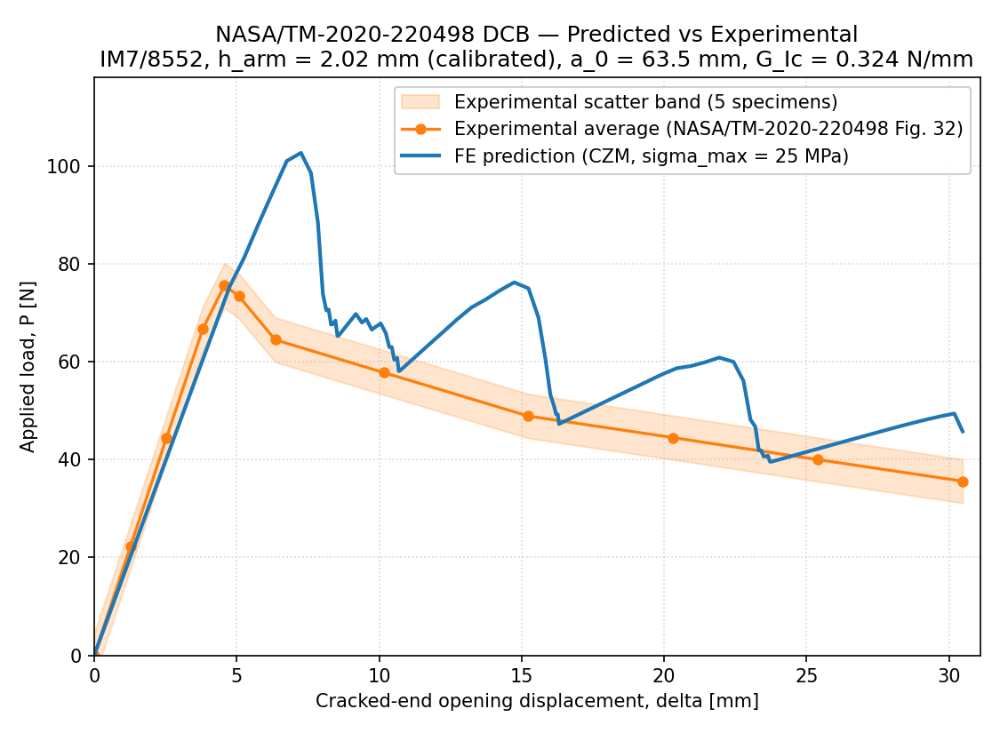
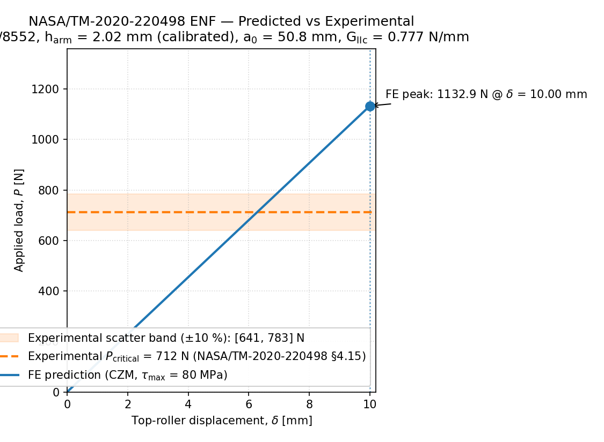
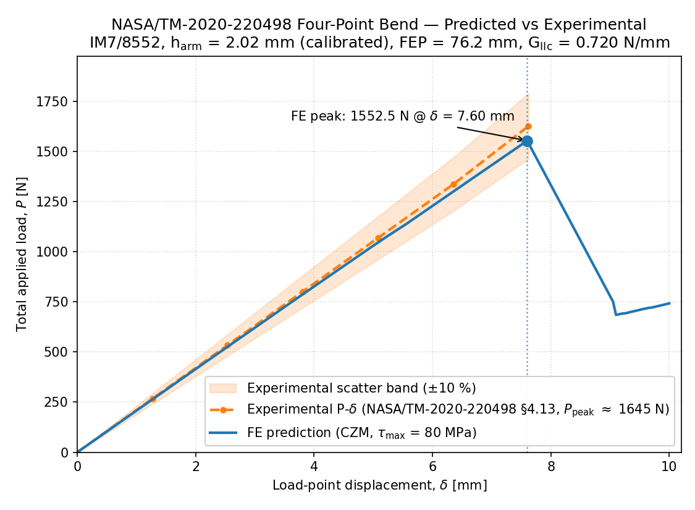
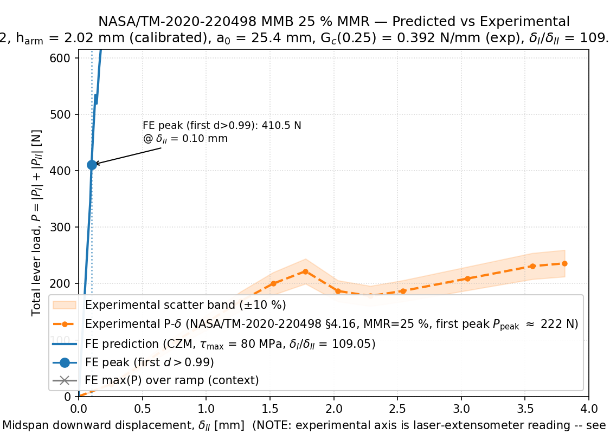
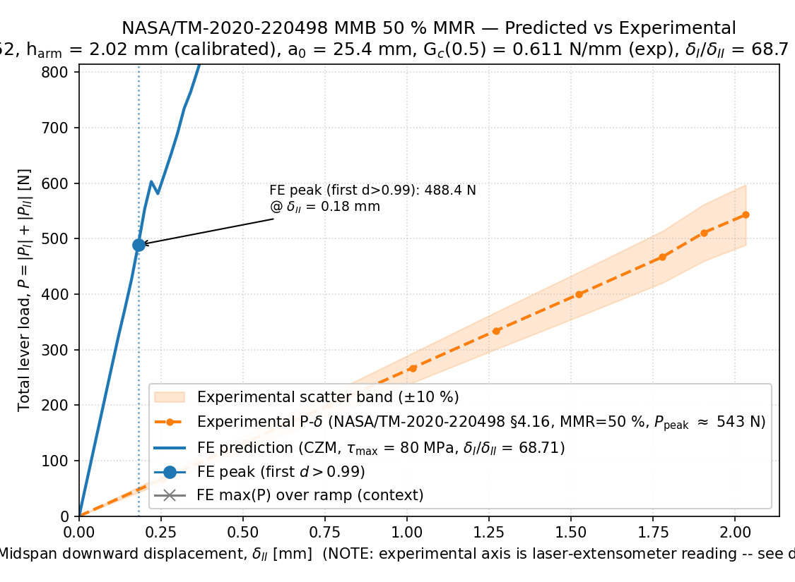
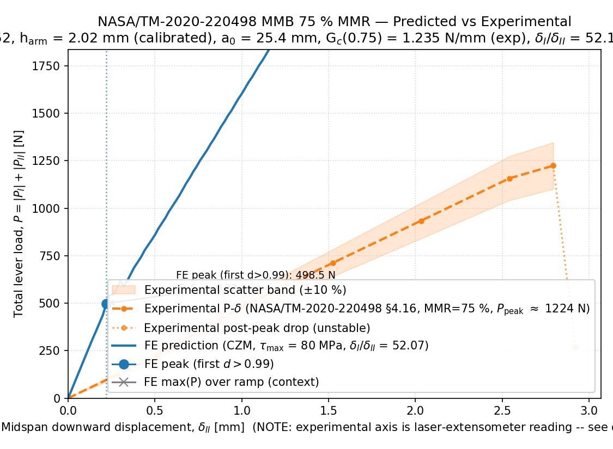
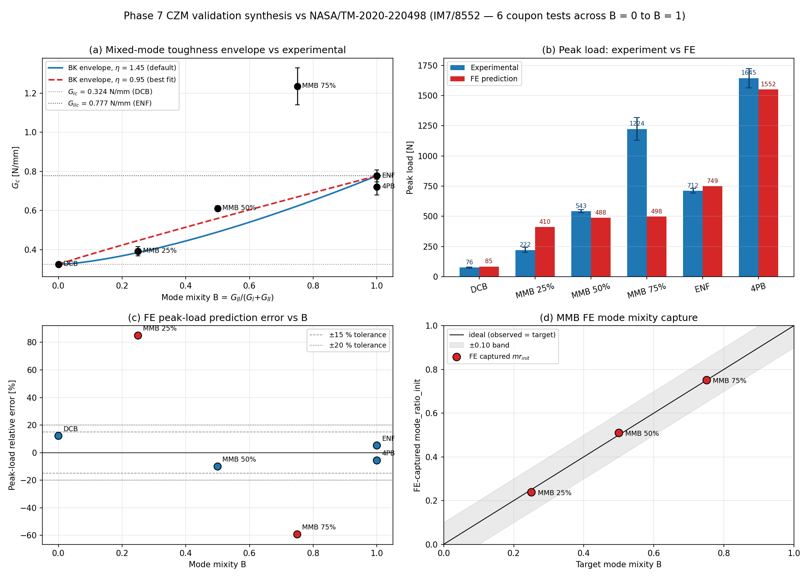
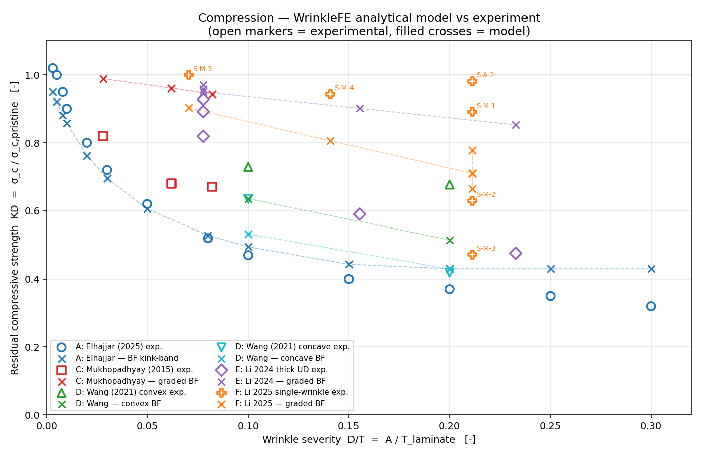
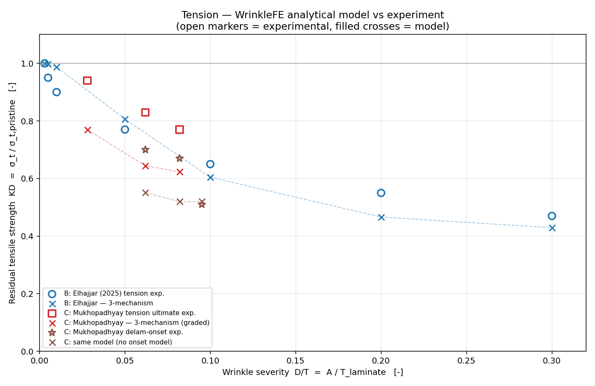

# WrinkleFE Validation Ledger

This file tracks every external paper assessed for inclusion in the
WrinkleFE knockdown validation database, with the decision and rationale.
The active validation dataset (data points, pass counts, MAE) lives in the
**Validation** section of [README.md](../../README.md); this file is the
evaluation history behind it.

## Inclusion methodology

A paper qualifies as a knockdown validation point when it reports, for a
**flat coupon containing fiber waviness**:

- a material with tensile/compressive strength allowables (Xt / Xc),
- the stacking sequence and ply thickness,
- the wrinkle geometry (amplitude A, wavelength λ, or peak misalignment θ),
- the loading mode (tension or compression),
- the measured strength (or knockdown) of the wrinkled vs pristine coupon.

Each case is run through `WrinkleAnalysis`; predicted vs measured knockdown
gives the per-point error, aggregated into the README table.

## Reproducible harness

The machine-readable ledger lives at `tests/test_validation/ledger.json`
(per-case analysis recipe, measured knockdown, and a pinned analytical
baseline computed by the current code). One command recomputes every
case and fails on drift from the pinned baselines:

```bash
python scripts/validate.py            # compare; exit 1 on drift
python scripts/validate.py --update   # re-pin after a deliberate model change
```

`tests/test_validation/test_ledger.py` runs the same comparisons in CI.
The pinned values are regression baselines, not claims of experimental
agreement — the measured-vs-predicted error per dataset is printed
alongside. This is the harness whose absence forced the revert of the
graded-decay fix (issue #254, commit `00584b4`). The ledger currently
holds the Li (2025) single-wrinkle compression cases, Hsiao & Daniel
(1996) and the Shi (2025) Dataset H pair (the first in-repo
multidirectional measured strengths); the remaining multidirectional
case data (Elhajjar 2025, Mukhopadhyay 2015, Li 2026) are not yet in
the repository and should be added to the ledger as their points land.

### Regime-conditional validation margins (issue #455)

The NCR summary and the results JSON report a validation margin with
every analytical knockdown. That is the factor that would have kept 95%
of the knockdown's regime conservative, and "insufficient evidence"
below 10 cases. The definition, method and current table are in
[Interpreting results](../interpreting_results.md), "`validation_margin`".

The margins are fitted from this ledger's non-quarantined residuals
(measured over the pinned prediction). The ledger is not installed with
the package, so they ship as package data,
`src/wrinklefe/core/validation_margins.json`:

```bash
python scripts/fit_margins.py           # check: exit 1 if the shipped table is stale
python scripts/fit_margins.py --write   # regenerate it from the ledger
```

`python scripts/validate.py --update` re-pins the baselines and then
regenerates the table, so a deliberate model change is still one
command. `python scripts/validate.py` fails while the table is stale,
as does `tests/test_validation/test_margins_ledger.py`. Commit the regenerated
table with the re-pinned ledger.

The bending regime of a validation case is measured on the specimen's
own wrinkle geometry. Where the knockdown recipe does not reproduce
that geometry, the dataset carries an `eccentricity_recipe` of config
overrides used only for this measurement. Today that is Dataset H's
one-sided trough, `tool_flat` with a 10-ply ramp, as in
`validation/bending_mode_study.py`.

A user who models such a trough the way the knockdown recipe does gets
no bending warning (issue #461). `graded` with decay floor 0 keeps both
outer surfaces flat. On Shi's recipes it measures e/t = 0 on the UD half
(the centroid of a section with flat surfaces is midway between them)
and 0.012 to 0.030 on the multidirectional half. The `eccentricity_recipe`
gives 0.05 to 0.18 and flags the 20% and 30% troughs. No detector was
added, because nothing in a `graded` trough's inputs separates it from
an embedded wrinkle. Over the 31 `graded` compression cases (the ledger
plus Datasets C and E), Krishnappa's embedded L-WM-4-3 has a higher
amplitude-to-thickness ratio (0.207) than Shi's 20% troughs (0.200). Li's
embedded S-M-3 has a higher amplitude-to-wavelength ratio (0.093 against
0.069) and peak angle (30° against 23.5°). Every single-metric threshold
that warns on Shi's 20% troughs therefore also warns on an embedded
wrinkle. The product of the two ratios does split them, at 0.0138
against 0.0113 for the nearest embedded case. That boundary is fitted
to Shi's two trough geometries (the UD and multidirectional halves
share them) and has no mechanism behind it, so it was not adopted.
Users are steered to `tool_flat` instead:
`docs/interpreting_results.md` ("One-sided surface troughs"), the app's
**Morphology** help and the CLI's `--morphology` help
(`wrinklefe.core.eccentricity.ONE_SIDED_TROUGH_ADVICE`).
`tests/test_trough_morphology.py` pins these numbers and checks that
no embedded case is flagged.

## Included datasets

See the table in [README.md](../../README.md). Current sources:

- Elhajjar (2025), *Scientific Reports* 15:25977 — compression + tension.
  Not in the ledger (scored by `validation/strength_error_summary.py`).
  Its `uniform` recipe makes the five largest compression wrinkles
  bending-dominated whole-thickness waves (e/t 0.10–0.31), so the
  eccentric-column bending bound (issue #452) applies to them. It
  governs on the two most severe, moving A = 0.61 mm from +18.5% to
  +13.1% and A = 0.73 mm from +29.6% to +10.4%; the kink-band stays
  lower on the other three.
- Mukhopadhyay, Jones & Hallett (2015), *Compos. A* 73:132–142
  (compression) and 77:219–228 (tension).
- Li, Y. et al. (2026), *Composites Part A* 205:109719 — S-glass/epoxy,
  compression (material `AC318_S6C10`).
- **Dataset E — Li, X. et al. (2024)**, *Composites Science and
  Technology* 256:110762 — UD glass/epoxy single-wrinkle compression,
  9 cases, **moulded** material realization (material card
  `AC318_S6C10`). Normalised ÷830 MPa (indicative — the paper reports
  no measured pristine).
- **Dataset F — Li, Li, Ge & Liang (2025)**, *Polymer Composites*
  46:15176–15187 — UD glass/epoxy single-wrinkle compression, 6 cases
  (incl. the near-surface position case S-A-2), **vacuum-bag**
  realization with a measured pristine of 335.5 MPa (material card
  `AC318_S6C10_vacbag`, measured Xc = 335.5, E1 = 50.8 GPa).
- **Dataset G — Hsiao & Daniel (1996)**, *Composites Science and
  Technology* 56(5):581–593 — UD **carbon**/epoxy (IM6G/3501-6, material
  card `IM6G_3501_6`) periodic waviness under compression, with measured
  defect-free baselines. Two specimens: a *uniform*-waviness coupon
  (θ ≈ 15°, modulus knockdown 0.571) and a *graded*-waviness coupon
  (θ ≈ 7.2°, modulus knockdown 0.941, strength knockdown 0.660). The
  first carbon system and the first dataset carrying a measured
  **stiffness** knockdown — see *Stiffness / modulus validation* below.
  The uniform coupon has no measured strength, so its analytical
  strength baseline is a pure regression pin: 0.109 → 0.142 when the UD
  strain budget moved to the card's S12/Xc = 0.043 (issue #451). The
  graded coupon (0.513, −22.3%) is unchanged.
- **Dataset H — Shi, Yang, Sun, Zheng, Qian, Wang & Song (2025)**,
  *Materials* 18:4503, DOI 10.3390/ma18194503 (CC BY, so the measured
  values are transcribed directly from the paper's text — no digitised
  figures). Two 20-ply CFRP laminates (T700-class vendor card
  `T700_SHI2025`), 140 × 12 × 3.8 mm, ASTM D6641 compression, each with
  a **single one-sided wrinkle**: a trough of depth t at the top
  surface over a 5.5 mm span, decaying to a flat bottom (t/T = 10/20/
  30% → peak angles 12.2/23.5/33.1°, D/T = t/T).
  - **H-UD** `[0]_20`: measured KD 0.638/0.494/0.400 (pristine 39.5 kN
    = 866 MPa; vendor Xc is 1450 — clamped-end D6641, so knockdowns are
    ratios to the measured pristine). Third UD strength set, first
    carbon one with an amplitude sweep at fixed span. Plain analytical
    (Budiansky–Fleck floor): +0.2/+11.8/+25.9% — dead-on at 12° and
    drifting unsafe with angle, the saturation the penetration gate
    exists for; no gate preset is calibrated for this material yet
    (3 points would overfit the gate — wait for more carbon data).
    First-ply FE (tool_flat recipe, nx = 48): −26.2/−36.7/−39.9%,
    strongly conservative — the FE sees the full local concentration
    of this short-span wrinkle while the specimens carry on past
    first-ply failure.
  - **H-MD** `[45/0/−45/90/45/0/−45/0/45/0]s`: measured KD
    0.760/0.475/0.326 (pristine 33.7 kN = 739 MPa). **The first
    measured multidirectional strength set in the ledger**, and the
    severities are *worse* than the UD half at the same t/T — the
    paper attributes the 30% failures to buckling participation from
    the one-sided stiffness asymmetry, which no first-ply path models.
    The analytical path over-predicts badly here (+5.8/+55.6/+115.2%)
    and the docs steer multidirectional users to the FE accordingly.
    **First-ply FE retention: −7.7/−7.4/−0.9%** — conservative
    across the board (`FE_STRENGTH_CAVEAT` now carries this; the slow
    test in `tests/test_fe_strength_caveat.py` keeps it true).
    Mesh-checked at nx = 64 (every error within 2.5 points of nx = 48;
    MD −5.8/−5.0/−3.0%). The card's GIc/GIIc are literature-typical
    T700/epoxy values, not from the paper; they set LaRC05's in-situ
    strengths, so the FE figures rest on that choice (documented on
    the card).
  - Geometry representation: the ledger's analytical recipe is the
    plain graded profile (the analytical path reads only the peak
    angle); the FE recipe is `morphology='tool_flat'`, flat face on
    the bottom, 10-ply ramp — for these symmetric layups the
    flat-bottom *crest* it builds is the z-mirror of the paper's
    flat-bottom *dip*, and the mirror is a symmetry of the specimen,
    so the response is equivalent. The real assumption is the decay
    shape itself (the paper sketches it; Figs. 3 and 8).
  - Context reference: Luong, Trevarthen, Butler, Srisuriyachot & Lunt
    (2025), *Composites Part B* 307:112818 — a CC BY review compiling
    wrinkle knockdown ranges (compressive 30–75%); no case-level data,
    cited for context only.
- **Dataset I — Calvo, Quiñonero-Moya, Feito, Miguélez et al. (2023)**,
  *Composite Structures* 323:117498 (© Elsevier; values transcribed
  with citation). The first **tension** strength set since B/C, the
  first **distributed multi-wave** case, and the first experimental
  exercise of WrinkleFE's multi-wrinkle composition. 22-ply M21E/IMA
  `[45/0/−45/90/0/90/0/90/−45/0/45]s`, 200 × 15 × 4.1 mm, quasi-static
  tension; material card `M21E_IMA` from the paper's MEASURED ply table
  (E1 167, E2 9.5, G12 5.8 GPa, ν12 0.21, Xt 2938, Yt 53, S12 145 MPa;
  the rest inherited from `T800S_M21`).
  - **Geometry:** seven transverse-strip waves at 17.5…77.5% of the
    length (20 mm pitch), centre wave 2 plies below the top, the others
    7/13/18 plies below it moving outward — encoded with the ledger's
    new `wrinkle_placements` recipe field (a station + interface per
    wave). The paper's three wave numbers are mutually inconsistent for
    a sinusoidal bump (λ 9.6 mm & δ 0.5 mm imply a 9.3° tangent, but the
    measured θ is 6.8°); the recipe keeps the measured height and
    matches the measured angle (bump length 13.2 mm), since the peak
    angle is what the models consume. Matching via δ instead gives the
    same analytical KD within 0.4%; the literal 9.3° reading gives
    0.613 (documented sensitivity).
  - **Measured (batch means, B5 vs B4):** strength KD **0.841**
    (930 / 1106 MPa); initial modulus 0.992; end-of-test modulus 0.906
    (after off-axis ply cracking).
  - **Analytical (three-mechanism tension): 0.770, −8.4%** —
    conservative, inside ±20%, matrix-mechanism governed. Calvo's own
    CLT-with-waviness model predicts 0.643 on the same basis, so the
    shipped analytical path lands closer to their test than their model
    does. Closed-form modulus KD 0.945 vs 0.992 initial (−4.7%).
  - **First-ply FE retention: 0.624, −25.7%** (nx = 200; 0.640 at
    nx = 300) — conservative against the ultimate by construction:
    first-ply in tension is off-axis matrix cracking, while the measured
    ultimate is fibre-governed after those plies crack. Against a
    measured damage *onset* it is not conservative: on Dataset M it was
    unsafe on 9 of 12 coupons (−22% to +154%, issue #436). Sensitive to the unmeasured
    decay floor (0.45–0.62 over floors 0.25–0.75 at the literal
    geometry).
  - **Caveats:** effectively one strength point (a batch mean of
    interacting waves); waves made by inserted strips (local thickening
    travels with the waviness); decay toward the tool face unmeasured.
  - Found while integrating it: `AnalysisConfig(loading="tension")`
    kept the default compressive `applied_strain = -0.01`, so the FE
    solved in compression while the analytical path reported tension.
    The app was unaffected because it signs the strain from the loading.
    This is now fixed: an unset strain follows `loading`, and a
    contradicting one raises. The Dataset I recipe still sets
    `applied_strain` explicitly.
- **Dataset J — Thor, Mandel, Nagler, Maier, Tauchner, Sause &
  Hinterhölzl (2021)**, *Int. J. Material Forming* 14:19–37,
  DOI 10.1007/s12289-020-01540-5 (CC BY 4.0). The **second lab** with
  severe multidirectional compression (issue #434). IM7/8552 (existing
  card `IM7_8552`), 0.131 mm plies, quasi-isotropic `[0/45/−45/90]5s`
  and UD `[0]40`. Sinusoidal waves were moulded on a one-sided female
  tool, so the whole laminate is wavy (a globally curved coupon):
  recipe `morphology='uniform'`. Five specimens per configuration,
  ASTM D6641; Table 3 means.
  - **Geometry:** wave 1 A = 1.19 mm, L = 27.9 mm (θ = 15.0°,
    A/t = 0.23); wave 2 A = 0.29 mm, L = 14.5 mm (θ = 7.2°, A/t = 0.06).
    The methods text gives A₂ = 0.58 mm, but four figure legends and
    captions and the measured profile (2A = 0.58 mm) give 0.29 mm; with
    0.58 mm the quasi-isotropic wave 2 analytical error would be −21%
    instead of −8%.
  - **Measured strength KD:** quasi-isotropic **0.347** / 0.678; UD
    0.252 / 0.496. Moduli are in the ledger too (quasi-isotropic
    0.537 / 1.067, UD 0.490 / 0.846).
  - **Analytical:** quasi-isotropic wave 1 **+15.1% (unsafe)** with the
    eccentric-column bending bound (+52.1% with the kink-band alone),
    wave 2 −7.9%; UD −10.0% / −23.2% with the material-anchored UD
    budget (S12/Xc = 0.077, issue #451; −56.8% / −58.9% with the layup
    model's 0.032). Before the bound, the severe quasi-isotropic miss
    matched Shi's (+56% / +115%) from an independent lab.
  - **Re-pinned (issue #452):** J-QI-1 `expected_analytical_kd`
    0.5271 → 0.3990. Wave 1 is a whole-thickness wave (both surfaces
    follow the load path) at e/t = 0.251, so the bound
    (t_c/t_0) / (1 + 6 e/t_c) = 1 / (1 + 6 × 0.251) applies and is
    below the kink-band value. It is the only ledger case the bound
    moved. J-UD-1 has the same geometry and the same bound (0.399), but
    its kink-band value (0.227 with the UD budget of issue #451) is
    lower and stays; wave 2 (e/t = 0.061) is below the threshold.
  - **First-ply FE (ledger recipe, nx = 48):** quasi-isotropic −8.8% /
    −3.6%; UD −5.0% / +2.2%. Mesh-checked: nx = 72, nz_per_ply = 2 or
    ny = 4 move it by at most 0.03. The mesh carries the coupon's own
    waviness, so the FE sees the bending the angle model cannot.
  - **Blind gate (UD):** moulded preset 0.496 / 0.761 against 0.252 /
    0.496 measured (+97% / +53%, unsafe); the vacuum-bag preset is
    further off.
  - **Mechanism (the paper):** wave 1 fails by bending from the wave
    geometry, delamination first and then fibre breakage; wave 2 by
    fibre kinking then delamination. A bending model is issue #439.
  - **Caveats:** the pristine reference is a thinner planar coupon
    (16 plies, 2.1 mm, 10 mm wide; 3 specimens for quasi-isotropic)
    than the 40-ply wavy coupons, so the knockdowns may carry a
    thickness effect (the quasi-isotropic wave 2 modulus ratio of 1.07
    points that way); globally curved coupons, not embedded wrinkles.
- **Dataset K — Pilato, Butler, Trevarthen & Lunt (2022)**,
  *Materials & Design* 222:111055, DOI 10.1016/j.matdes.2022.111055
  (CC BY 4.0). The first **naturally occurring** wrinkles: coupons cut
  from an industrial part. Near-UD carbon `[0₄/0ʷ/0₂/0ʷ/0]` (UD plies
  0.355 mm, woven 0/90 plies 0.31 mm, 3.1 mm), ASTM D3410. New card
  `UD_CFRP_PILATO2022` from the paper's Tables 1–3 (E1 115 GPa,
  Xc 754 MPa). The recipe represents each UD ply as two 0° sub-plies
  and each woven ply as a 0/90 pair: 18 sub-plies at 3.1/18 mm, 11% at
  90° against about 10% in the real laminate.
  - **Geometry:** Side-1 peak-to-peak amplitudes and mean wavelengths
    (Table 13), which reproduce the paper's Table 14 severities
    (A/L 0.0147–0.0184, θ 5.3–6.6°). Side 2 is about half as steep
    (about 3°): the wrinkle varies across the coupon width. The
    effective wrinkle height (10.8–16.9 mm) exceeds the thickness, so
    the wrinkle spans it: `morphology='uniform'`.
  - **Measured strength KD:** 0.586–0.684 (5 coupons), against a
    pristine mean of 689.9 MPa (4 coupons, CV 2.5%).
  - **Analytical (kink-band): −17% to −23%** with the material-anchored
    UD budget (S12/Xc = 0.102, issue #451). The layup model gave −77% to
    −79%: its block penalty drove this near-UD laminate to the 0.016
    floor.
  - **First-ply FE (ledger recipe, nx = 48): −1.2% to +9.3%.**
  - **Blind gate:** moulded preset +22% to +36%, vacuum-bag +46% to
    +70%, both unsafe. The gate reads D/T as amplitude over thickness,
    about 0.04 here, although the wrinkle penetrates the whole
    thickness: amplitude ratio and penetration depth are different
    quantities, and papers rarely report the second.
  - **Caveats:** one severity cluster; each coupon has its own natural
    geometry; the material is unnamed; two woven plies approximated.
- **Dataset L — Krishnappa & Gururaja (2024)**, *Composites Part B*
  284:111688, DOI 10.1016/j.compositesb.2024.111688 (© Elsevier; values
  transcribed with citation). The **≥5-severity UD carbon set** issue
  #435 asked for. **Quarantined (issue #445).**
  - **Why quarantined.** It is a low-quality wet lay-up laminate and does
    not compare like-for-like with the other datasets:
    - stitched UD carbon fabric, wet lay-up, room-temperature cure under a
      vacuum bag;
    - Vf 0.46 and 4.2% porosity, with stitching micro-wrinkles in every
      ply;
    - the pristine coupons bent 15% in test, over ASTM D6641's 10% limit,
      and fail at 0.44% strain, against 0.60–0.77% on the other UD carbon
      sets (H, J, K);
    - the wrinkles are inserted 90° strips up to 37% of the thickness.
  - **What quarantine means.** The ledger's `quarantine` entry keeps the
    dataset and its pinned baselines (still a regression guard). It is
    reported on its own: left out of the parity headline count, pooled
    statistics, and the evidence behind the model-choice guidance. An
    analysis that states `manufacturing_process="wet_layup"` now carries
    an out-of-scope warning citing this dataset (see "Manufacturing-process
    scope" below). More wet lay-up data is issue #445.
  - **Material and test.** Wet-laid YC300 carbon / LY5052 epoxy, `[0]8`,
    2.8 mm, Vf 0.46, 4.2% porosity, ASTM D6641; 78 specimens. New card
    `YC300_LY5052` with the paper's measured E1 98 GPa, Xc 432.7 MPa,
    G12 3.94 GPa, S12 40.8 MPa and shear yield strain 1.08% (γ_Y); the
    other entries are typical values, marked as approximate.
  - **Wrinkles.** A 90° laminate strip (1–3 plies, 2 or 4 mm wide) was
    inserted at three positions: under the first (tool-side) ply (WR),
    between the middle plies (WM) and under the last ply (WL). That gives
    18 configurations at 7.7°–30.2° (Table 1).
  - **Recipe.**
    - WM: `graded` (embedded, flat surfaces).
    - WR: `uniform` (every ply lifted).
    - WL: `uniform` on the analytical path, which reads only the profile.
      Its `fe_recipe` is `tool_flat`, with the flat face at the bottom and
      a 7-ply ramp.
    - Wavelength = 2πA/tan θ, so the recipe reproduces the measured angle
      (as for Dataset I).
    - The 90° strip and its resin pocket are not modelled.
  - **Data provenance.** Strengths and amplitudes appear only in figures,
    so they were read from the article's **vector** graphics, giving exact
    plotted coordinates rather than readings by eye.
    - The Fig. 7 pristine bar reproduces the text's 432.7 MPa.
    - Every wrinkled knockdown agrees with Fig. 8b within 0.22 points.
    - Every Fig. 8b angle agrees with Table 1 within 0.11°.
    - Fig. 8a (amplitudes) has four colour errors in its 2 mm series. Each
      point is attached to its configuration by its knockdown value, which
      Figs. 8a and 8b share exactly.
  - **Measured strength KD:** 0.27–0.79.
  - **Analytical (kink-band):** conservative on all 18 cases, mean
    −31.7%. WM (`graded`) −7% to −34%. WL and WR (`uniform`) −23% to
    −48%, with the UD budget S12/Xc = 0.094 from the card's measured
    S12 and Xc (issue #451; −68% to −79% with the layup model's 0.032).
  - **First-ply FE** (nx = 48; refinement changes it by at most 0.04)
    depends on position:
    - WM: **+22% to +100%, unsafe**, as on the other embedded
      flat-surface sets (C, D, E).
    - WL: −4% to +25%.
    - WR: −50% to +25%.
  - **Load-path eccentricity (#439).** All six WR cases and four WL
    cases (WL-2-2, WL-2-3, WL-4-2, WL-4-3) sit at e/t ≥ 0.10. On these
    UD cases the kink-band stays conservative, unlike on the
    multidirectional cases. They are whole-thickness waves (`uniform`
    recipe), so the eccentric-column bending bound of issue #452 is
    applied (0.25 to 0.57), but the kink-band (0.06 to 0.18) is lower on
    every one, so no pin moved.
  - **Caveats:**
    - Low-quality laminate: wet layup, 46% Vf, porosity, and micro-wrinkles
      from the glass stitching yarn.
    - The wrinkle is an inserted 90° strip with a resin pocket.
    - Scatter is up to ±38 MPa.
- **Dataset M — Elhajjar & Shams (2016)**, *Composites Science and
  Technology* 122:140, DOI 10.1016/j.compscitech.2015.11.026, with the
  control strengths of El-Hajjar & Petersen (2011), *Composite
  Structures* 93:2400. The first tension set with a **measured damage
  onset and ultimate for every wrinkled coupon** (issue #436). The same
  specimens are in Shams (2016), PhD thesis, UW-Milwaukee (Tables
  5.1–5.2).
  - **Material and test.** Toray T700GC-12K-31E / #2510 prepreg,
    press-claved; 16 plies, about 2.4 mm. Nine multidirectional
    `[0/45/90/-45/0/45/-45/0]s` and four UD `[0]16` coupons, ASTM D3039,
    the wrinkled ones untabbed. New card `T700GC_2510_AGATE` from the
    AGATE allowables (Tomblin et al. 2002) as both papers tabulate them;
    the generic `T700_2510` card, which Datasets A/B use, is unchanged.
  - **Wrinkles.** Close-tolerance steel rods under a Teflon sheet, removed
    after cure: a one-sided dip, sharpest under the first ply where resin
    pools and fading to the flat back face. Heights A = 0.3–0.8 mm
    (multidirectional, four sizes) and 0.28–0.35 mm (UD, two sizes),
    lengths L = 1.3–4.6 mm.
  - **Recipe.**
    - Peak angle: measured for specimens 1–5 (30° and 23°, Fig. 2) and
      matched. For the rest, wavelength = 2L (Dataset H's convention),
      which gives 22–36°, in line with the 34° slope of El-Hajjar &
      Petersen's Gaussian fit for the same rod method.
    - Analytical: graded at the mid interfaces (it reads only the
      profile). FE: `tool_flat` with the flat face at the bottom and a
      ramp over 15 of the 16 plies, as the dip fades through the whole
      thickness.
  - **Baselines.** Control ultimates 765 MPa (multidirectional) and
    1785 MPa (UD): the values the 2016 paper normalised by. Its ratio
    column (limit point / control ultimate, two decimals) bounds them to
    763–768 and 1783–1786 MPa. El-Hajjar & Petersen (2011) plot the
    multidirectional controls at 731–765 MPa with CoV < 1%.
  - **Onset.** The DIC limit point is the first jump in the surface's
    out-of-plane displacement; microscopy ties it to interlaminar damage,
    with no load drop. No pristine onset is reported, so the onset
    knockdown is the limit point over the pristine ultimate (the paper's
    own normalisation), and first-ply FE is compared in absolute stress:
    the wrinkled coupon's nominal stress at first ply failure. Specimen
    12 was preloaded to 600 MPa before its DIC test and is left out of
    the onset score.
  - **Analytical (three-mechanism) against the ultimate (after issue
    #454):** multidirectional signed mean −4.9%, −21.9% to +14.2%,
    unsafe on 3 of 9; UD −2.8%, −22.7% to +17.6%, unsafe on 2 of 4.
    These wrinkles are steep (22–36°), steeper than any other tension
    dataset here.
  - **Re-pin for issue #454 (all 13 cases drift; nothing else in the
    ledger moves).**

    | Cases | Pinned before | Pinned after | Error before → after |
    |---|---|---|---|
    | M-MD-1, -2 (30°) | 0.7021 | 0.6185 | +24.0 / +29.6% → +9.2 / +14.2% |
    | M-MD-3 to -5 (23°) | 0.7908 | 0.6559 | +1.4 / +14.4 / +20.0% → −15.9 / −5.2 / −0.4% |
    | M-MD-6, -7 (~36°) | 0.7082 | 0.5986 | +2.1 / −7.6% → −13.7 / −21.9% |
    | M-MD-8, -9 (~34°) | 0.7044 | 0.6033 | +0.7 / +20.5% → −13.7 / +3.2% |
    | M-UD-10, -11 (~27°) | 0.5388 | 0.4205 | −1.0 / −0.5% → −22.7 / −22.3% |
    | M-UD-12, -13 (~22°) | 0.5617 | 0.4747 | +37.4 / +39.2% → +16.1 / +17.6% |

    - *Why every value moved.* Before #454 each of the 13 was the
      compression (kink-band, graded profile-proportional) knockdown
      that floored the tension result. The three-mechanism value under
      it had collapsed: 0.32–0.44 multidirectional and 0.010–0.020 UD.
    - *Three causes of the collapse.*
      - The graded per-ply average charged every 0° ply the crest
        curvature, so a ply the grading leaves flat still carried
        `KD_oop` 0.04–0.24 (UD 0.010).
      - The interlaminar tractions had no bound, so delamination was
        treated as the end of the ply's load path. These coupons
        delaminated at 11–30% of the pristine ultimate and failed at
        40–78%.
      - On the `[0]16` block the thin-ply in-situ shear formula gave
        66.5 MPa, below the lamina's own 154.4 MPa.
    - *The fix* attenuates each ply's curvature with its angle, bounds
      each traction by its interface strength, bounds the in-situ shear
      by `S12`, and drops the floor. None of the four adds a fitted
      constant. They were diagnosed on these coupons, though, so the
      agreement above is in-sample.
    - *Contributions.* The per-ply curvature alone takes the
      multidirectional half to −7.1% without the floor. The traction
      bound takes it to −4.9%. The UD half needs all three: −65% with
      the curvature fix alone, −35% with the bound added.
    - *Elsewhere.* Elhajjar B (uniform, below the interface strength
      where `KD_oop` governs), Calvo I and the Mukhopadhyay onset are
      bit-for-bit unchanged. Mukhopadhyay tension rises from −19.9% to
      −12.2%: its outer plies were also charged the crest curvature, and
      the floor had held two of its three cases. Every compression case
      is bit-for-bit unchanged.
    - *Issue #451.* That issue changes the kink-band strain budget, but
      only on the non-graded UD path, so it never moved Dataset M's
      floor. Tension no longer reads the kink-band value at all, so no
      compression recalibration can move a tension result.
  - **First-ply FE against the onset:** unsafe on 9 of 12 scored
    coupons, from −21.7% to +154.0%, median +28.6%.
    - Within −22% to +46% on the smaller wrinkles (multidirectional
      A ≤ 0.6 mm, UD A = 0.28 mm).
    - +74% and +134% on the 30° multidirectional pair (A = 0.8 mm), and
      +154% on the larger UD wrinkle.
    - The limit point marks interlaminar damage, which an intralaminar
      first-ply criterion does not represent; the misses are largest
      where the dip is deepest.
  - **First-ply FE retention against the ultimate:** conservative on all
    13 (−27% to −58%), as on Dataset I.
  - **Sensitivity.** A ramp over 8 plies instead of 15 lowers every FE
    onset by 14–21%; nx = 64 instead of 48 moves it by about 1%.
  - **Caveats:**
    - Peak angles are estimated for 8 of the 13 coupons, including both
      UD groups. The larger UD wrinkles knock down more (0.40 against
      0.54) at a lower estimated angle (22° against 27°), so that
      estimate is the weakest input.
    - Delamination onset from the cohesive-zone path would be the closer
      comparison, but the solver does not yet record damage per load
      increment.

### Stiffness / modulus validation

Everything above scores **strength** knockdown. WrinkleFE also predicts a
**stiffness** (axial Young's-modulus) knockdown, exercised by
`validation/validate_modulus.py` against every UD dataset that reports a
measured modulus:

- **FE** — the linear static solve's `modulus_retention` (mean
  fibre-direction stress / applied strain, wrinkled vs pristine).
- **Analytical (driver-local)** — `validate_modulus.py`'s own
  `analytical_modulus_kd()`: a closed-form CLT series-average of the
  off-axis lamina modulus over the wrinkle profile, the same
  off-axis-compliance integration as Hsiao & Daniel (1996), at zero FE
  cost.

**Read the "analytical" column carefully: it is the driver's own
function, not the package's.** `validate_modulus.py` never calls
`AnalysisResults.analytical_modulus_knockdown`; it computes its own
estimate. The two are *not* interchangeable — on Dataset F they differ
by up to 12 percentage points per case, and the shipped predictor scores
roughly twice as poorly:

| Dataset F predictor | mean abs error |
|---|---|
| `validate_modulus.py :: analytical_modulus_kd()` (the table below) | 3.8 % |
| shipped `analytical_modulus_knockdown` (#324, pinned in the ledger) | 7.5 % |

A user calling `WrinkleAnalysis` gets the second one. This section
previously described the table's analytical column as being the shipped
`analytical_modulus_knockdown`, which flattered the package by about a
factor of two; corrected 2026-09-29.

| Dataset | Material | analytical MAE (driver-local) | FE MAE |
|---|---|---|---|
| F — Li (2025) | S-glass/epoxy | 3.9 % | 6.9 % |
| G — Hsiao & Daniel (1996) | carbon/epoxy | 1.2 % | 5.1 % |
| E — Li (2024), indicative | S-glass/epoxy | 7.7 % | 10.3 % |

Both predictors confirm the datasets' headline: stiffness is far more
wrinkle-tolerant than strength — modulus knockdown stays 0.81–0.98 for
the Li S-glass cases and drops only to ≈0.52–0.57 for the carbon
uniform-waviness case at θ = 15° (whose *strength* would fall far
further). The analytical CLT tracks the angle, amplitude/penetration and
through-thickness-position axes; the homogenised-continuum FE is flatter
on the amplitude/position axes, consistent with the strength findings.
The modulus validation is **UD-only** — no multidirectional dataset in
the ledger reports a measured modulus knockdown.

`validation/plot_modulus_validation.py` renders the consolidated
predicted-vs-experimental view (`validation/fig_modulus_validation.png`):
modulus knockdown vs misalignment angle, and a parity plot, for all three
datasets — the stiffness counterpart of `plot_all_validation.py`.

### UD predictor: the two-parameter (θ, D/T, z) penetration gate

The adopted predictor for the UD single-wrinkle datasets (E, F) is the
penetration gate, `wrinklefe.core.penetration_gate`
(`AnalysisConfig.penetration_gate`), documented in
[WRINKLE_MODELING_FINDINGS.md](WRINKLE_MODELING_FINDINGS.md) (items D.3 /
D.5). It exists because angle-only Budiansky–Fleck knockdown is
**scale-invariant**: at a *fixed* peak misalignment angle, the Li grids
show knockdown still varying strongly with through-thickness penetration
(Li 2025 S-M-2/4/5: identical θ ≈ 20°, KD 0.63 → 1.00 as `D/T` falls).
The gate adds that second axis, and a third for wrinkle position:

```
KD = 1 − (1 − KD_angle(θ))·S(D/T)·P(z)
KD_angle(θ) = 1 / (1 + θ_rad / γ_Y)        # Budiansky–Fleck angle floor
S(D/T)      = min(1, (D/T / dt0)^p)         # penetration gate
P(z)        = (2·min(z, 1−z))^position_q    # through-thickness position
```

Two calibrated presets ship, one per material realization:
`GATE_LI2024_MOULDED` (Dataset E, moulded) and `GATE_LI2025_VACBAG`
(Dataset F, vacuum-bag; carries the position exponent for the
near-surface S-A-2 case). The gate is UD-scoped, has zero FE cost, and is
the package's best UD knockdown predictor.

### UD kink-band strain budget (issue #451)

**Change.** The kink-band's strain budget `gamma_Y_eff` came from the
layup confinement model alone: 0.032 for pure UD, down to a 0.016 floor
for blocked near-UD layups, whatever the material. That model was
calibrated on multidirectional laminates, and on the peak-angle path it
left UD carbon 58–78% conservative. Now a **UD-dominated** laminate on
the peak-angle path takes the budget from its material card:

```
g = S12 / Xc,   KD_BF = g / (g + theta_eff)   (default c_AF = 0)
```

This is Budiansky–Fleck with an intrinsic misalignment φ0. Kinking at
`σc = τY / (γY + φ0 + θ)` must give the pristine `Xc` at `θ = 0`, so
`γY + φ0 = τY / Xc ≈ S12 / Xc`, the same anchoring LaRC05 uses for its
intrinsic misalignment. The peak-angle path is every morphology except
`graded`, plus multi-wrinkle configs. Code: `_is_ud_dominated`,
`_ud_kink_strain_budget` and `WrinkleAnalysis._compute_analytical` in
`src/wrinklefe/analysis.py`; tests in `tests/test_ud_kink_budget.py`.

**UD-dominated means at least 75% 0° plies** (±5°, 0° ≡ 180°).
- Every multidirectional validation layup has at most 40% (A/B and
  M-MD 37.5%, C and J-QI 25%, D and H-MD 40%, I 36%).
- Pilato's near-UD laminate (K) has 89% (16 of 18 sub-plies). Its two
  90° sub-plies had put it on the 0.016 floor through the block penalty.
- Any cut in (0.40, 0.89] gives the same results. At 0.75 most 0° plies
  sit next to another 0° ply, where the confinement model's
  off-axis-neighbour argument no longer applies.

**Choosing the form.** Each variant was prototyped (by monkeypatching)
on every ledger dataset and on A–E before committing. Signed mean error,
unsafe count and worst case:

| Variant | J Thor UD | K Pilato | L [Q] | H Shi UD | M UD tension | G graded | E / F (BF column) |
|---|---|---|---|---|---|---|---|
| Layup model (before) | −57.9%, 0 | −77.5%, 0 | −55.8%, 0 | +12.6%, 2, +25.9% | +18.8%, 2, +39.2% | −22.3% | −37.4% / −58.2% |
| **g on the peak-angle path (adopted)** | **−16.6%, 0** | **−20.3%, 0** | **−31.7%, 0** | unchanged | unchanged | unchanged | unchanged |
| g on every path, `graded` too | −16.6%, 0 | −20.3%, 0 | −18.3%, 5, +44.6% | +34.8%, 3, +52.7% | +52.1%, 4, +77.6% | −13.1% | −12.3% / −38.6% |
| g / (g + θ_max) at the peak angle everywhere | −16.6%, 0 | −20.3%, 0 | −36.9%, 0 | −66.1%, 0 | −56.4%, 0 | −61.0% | −63.0% / −77.1% |

- **The bias is on the peak-angle path only.** The `graded` profile
  average is not biased conservative on UD carbon: its ten measured
  cases (G, H-UD, L-WM) average −10.5%. Its 0.032 was calibrated together
  with the averaging.
- **g on the `graded` path too fails the acceptance bar:**
  - H-UD-10 goes from +0.2% to +17.6% unsafe;
  - L-WM-2-3 goes from −6.9% to +44.6%;
  - Dataset M's UD tension floor went from −1.0% / −0.5% to +27% / +28%
    (issue #454 has since removed that floor, so tension no longer reads
    the budget at all).
- **Peak-angle-only everywhere over-corrects the other way** on the
  graded data (Shi −66%, M UD −56%).
- **The Argon–Fleck quadratic stays.** g replaces `gamma_Y_eff` inside
  the existing law, so the default `c_AF = 0` is exactly `g / (g + θ)`,
  and a user-set `kink_band_quadratic_coeff` still applies (the API is
  unchanged). The data do not support a non-zero default: `c_AF` = 0.1 /
  0.25 / 0.5 takes Thor UD to −29.5 / −42.1 / −55.0% and Pilato to
  −24.1 / −29.2 / −36.2%, all further on the conservative side.
- `AnalysisResults.gamma_Y_eff` reports the budget the path used.

**Re-pinned baselines: 20 ledger cases, all from this change.** Every
moved case is UD-dominated and on the peak-angle path.

| Cases | Budget before → after | Signed mean error before → after | Unsafe | Range after |
|---|---|---|---|---|
| J-UD-1, J-UD-2 (Thor, IM7/8552) | 0.032 → 0.0769 | −57.9% → −16.6% | 0 → 0 | −23.2% … −10.0% |
| K-6 … K-10 (Pilato) | 0.016 (floor) → 0.1021 | −77.5% → −20.3% | 0 → 0 | −22.9% … −16.7% |
| L-WL-*, L-WR-* (Krishnappa, 12 of 18, quarantined) | 0.032 → 0.0944 | −73.6% → −37.5% (dataset −55.8% → −31.7%) | 0 → 0 | −48.0% … −23.4% |
| HD-uniform (Hsiao & Daniel; no measured strength) | 0.032 → 0.0433 | KD 0.109 → 0.142 | — | — |

**Unchanged, bit for bit.** The analytical knockdown and `gamma_Y_eff`
are the same floats as before, checked under both loadings, for:
- A, B, C (compression, tension, onset), D;
- E and F (the kink-band column and the gate);
- G graded, H-UD, H-MD, I, J-QI;
- the six L-WM cases;
- M-MD and M-UD.

**Shi (Dataset H) does not get worse.** It is UD-dominated, but its
recipe is `graded`, so it keeps +0.2 / +11.8 / +25.9%. The alternative
of g on every path would have taken it to +17.6 / +34.1 / +52.7%. On the
peak-angle path (a `uniform` analytical recipe) it is strongly
conservative either way: −80% to −87% before, −59% to −71% now. Its
remaining unsafe miss is the one-sided-trough regime (issue #439), which
the two-sided-wave bending bound of issue #452 does not cover.

**Tension.** Tension takes the larger of its three-mechanism value and
the compression knockdown.
- Dataset M's four UD coupons all sit on that floor, but their recipe is
  `graded`, so they are unchanged: +18.8%, 2 of 4 unsafe, worst +39.2%.
- On the peak-angle path the floor now uses g for a UD-dominated
  laminate, so UD tension rises there with compression. No tension
  dataset takes that path. As a sensitivity, M UD run as `uniform` moves
  from −88% … −81% to −66% … −46%, still conservative.
- Every multidirectional tension set (B, C, I, M-MD) is unchanged.
- The tension recalibration in issue #454 should re-check this floor
  for UD-dominated peak-angle cases.

**Penetration gate.** The gate path returns before the kink-band block,
and its fitted `gamma_Y` is separate, so it is untouched: no gate pin
moves, and `validation/gate_transfer_study.py` is unchanged.
Re-fitting the gate's `gamma_Y` to one test at a time gives 0.057–0.088
on Thor (card S12/Xc 0.077) and 0.064–0.087 on Pilato (0.102), the same
order as the card values.

**Downstream numbers.**
- Analytical cases within ±20%: 55 → 58 of 77.
- Parity chart: 70 → 73 of 105.
- Bending-mode study (issue #439), from `bending_mode_cases.csv` with
  the new J-UD and K values: deployed MAE 20.9% → 13.5%, regime-selector
  MAE 16.8% → 10.4%. The unsafe counts are unchanged.
- Wet lay-up caveat (Dataset L): "about 56%" → "about 32%" conservative.

### Gate transfer to new materials (issue #435)

**The presets do not transfer blind. Whether one wrinkled test
calibrates them is unresolved.** `validation/gate_transfer_study.py`
scores both presets on the UD carbon datasets neither was fitted to:
Shi (H), Thor (J) and Pilato (K), 10 cases, plus the quarantined
Krishnappa & Gururaja set (L, 18 cases), reported on its own.

| Preset | Blind, as shipped | `gamma_Y` re-fitted to one case of a material, predicting its other cases |
|---|---|---|
| Moulded (dt0 = 0.094, p = 0.59) | unsafe on 7 of 10, worst +97% (L: 14 of 18, worst +45%) | Shi MAE 2%, Pilato 4% (3 and 5 cases); Thor −29% / +15% (2 cases). *L (quarantined): 306 predictions, MAE 17%, −42% to +71%, 81 more than 15% unsafe* |
| Vacuum-bag (dt0 = 0.122, p = 4.31) | unsafe on 10 of 10, worst +179% (L: 18 of 18) | 6 of 10 anchors cannot be reached; on L, MAE 29% |

Every case serves as the anchor in turn.
- **Where one test worked.** On Shi and Pilato the re-fitted `gamma_Y` was
  stable within each set (Shi 0.375–0.400, Pilato 0.064–0.087) and
  predicted the other cases within a few percent. Thor's two cases
  missed by −29% and +15%.
- **Where it failed.** On the quarantined Dataset L the re-fitted value
  spans 0.105–0.349 within one material, more than threefold. The gate
  takes only the angle and the amplitude-to-thickness ratio, so it
  cannot see the wrinkle's through-thickness position or extent, which
  dominate L. Even within one position (section 3 of the study) the
  error is 9–16% MAE, against 2–4% on Shi and Pilato. L's low quality
  may explain part of this, so it does not settle the question.
- **The vacuum-bag shape is too steep to transfer at all.** Its
  penetration term is about zero at Pilato's amplitude-to-thickness
  ratio (≈ 0.04), although those wrinkles span the whole thickness:
  amplitude ratio and penetration depth are different quantities.
- **Conclusion:** the gate is scoped to the material, process and
  wrinkle family it was fitted to. Using it elsewhere needs tests of the
  target material. Whether one test is enough needs a good-quality
  dataset that varies wrinkle position (issue #445, item 5).

`tests/test_validation/test_gate_transfer_study.py` pins these claims.

### Manufacturing-process scope (issue #445)

`AnalysisConfig.manufacturing_process` warns when a laminate's route is
outside the validated scope. The scope is the set of routes a
non-quarantined validation dataset documents, taken from
`wrinklefe.core.process.VALIDATION_EVIDENCE`; the ledger's `process`
entries must agree with it (`tests/test_process.py`).

| Dataset | Route | Where it is stated |
|---|---|---|
| A/B Elhajjar (2025) | prepreg, autoclave or hot press | the author (2026): T700/2510, high consolidation and fibre volume fraction |
| E Li (2024) | prepreg, press / closed mould | moulded at 2.9 MPa |
| M Elhajjar & Shams (2016) | prepreg, press ("press-claved") | El-Hajjar & Petersen (2011), Sec. 3.1 |
| F Li (2025) | prepreg, vacuum-bag oven cure | same prepreg, ~1 bar vacuum bag |
| J Thor (2021) | prepreg, autoclave | "fabricated in an autoclave" |
| L Krishnappa & Gururaja (2024) | wet lay-up (quarantined) | room-temperature cure under a vacuum bag |
| C, D, G, H, I, K | not recorded | prepreg systems (C, D, G, I) or not stated; they add nothing to the scope |

So the scope is the three prepreg routes: autoclave (A/B, J), press (A/B,
E, M) and vacuum bag (F). RTM, infusion, wet lay-up and "other" get the
warning. Recording the route of C, D, G, H, I and K would sharpen it.

**Laminate quality.** Each ledger dataset also carries a `quality` entry:
fibre volume fraction, porosity, test standard, whether the pristine
baseline met it, and the pristine failure strain where both strength and
modulus were measured. A field is `null` when the source does not report
it, so the gaps are recorded as well. Few sources report quality:

| Dataset | Vf | Porosity | Test standard | Baseline valid | Pristine failure strain |
|---|---|---|---|---|---|
| F Li (2025) | — | — | — | — | 0.66% (measured Xc and E1) |
| H Shi (2025) | 0.52 (nominal model input) | — | ASTM D6641 | — | — |
| I Calvo (2023) | — | — | ASTM D3039 | — | — |
| K Pilato (2022) | — | — | ASTM D3410 | — | — |
| L Krishnappa & Gururaja (2024) | 0.46 | 4.2% | ASTM D6641 | **no** (15% bending, limit 10%) | 0.44% |
| M Elhajjar & Shams (2016) | — | — | ASTM D3039 (wrinkled coupons untabbed) | — | — |
| G, J | — | — | — | — | — |

Only the quarantined dataset reports porosity or a failed validity check.
The others are not known to be better, only less documented: quarantine
rests on what a source reports, so a dataset that reports nothing about
its quality cannot be quarantined on quality grounds.
Penetration-gate presets also record their fit (the `AC318_S6C10` cards,
press or vacuum-bag cure) and warn when used outside it.

#### Decision: wet lay-up, infusion and RTM stay out of scope

A literature search (October 2026) for wrinkle strength data on
non-prepreg laminates found too little to validate any of them:

| Process | Usable datasets found | Leads that are not yet usable |
|---|---|---|
| Infusion / VARTM | 1, tension only: Nelson, Riddle & Cairns (2017), *Wind Energ. Sci.* 2:641, CC BY (MSU; E-glass/epoxy, 2 usable severities, in-standard D3039 baseline). Its compression data are not usable (the authors report bending and buckling) | Chen et al. (2012), DOE report DE-EE0001374 (UMass Lowell/TPI, compression; coupon data in an appendix that is not online); Barros et al. (2010), SAMPE (unverified, paywalled) |
| Wet / hand lay-up | none besides the quarantined Dataset L | — |
| RTM | none with more than one severity (Khan, Potter & Wisnom 2006, FPCM8: a single fold) | — |

So these processes stay outside the validated scope, and an analysis that
states one carries the out-of-scope warning. **A process enters the scope
when at least two wrinkle datasets from at least two labs, each with a
stated route and an in-standard pristine baseline, are in the ledger**
(issue #445). Adding Nelson (2017) as a flagged out-of-scope tension case
would be a first step for infusion.

### E vs F: two material realizations, no shared normalization

E and F are the **same prepreg system** (AC318 S-glass / S6C10-800) cured
two different ways: E **moulded** at 2.9 MPa, F **vacuum-bag** at ~1 bar.
The lower consolidation gives F roughly half the compressive strength
(F's measured pristine Xc = 335.5 MPa vs the moulded ÷830 MPa
normalization for E) — a ~2× difference. Because every E wrinkled
strength exceeds F's pristine, the two **cannot share an absolute KD
normalization**: pooling them is meaningless. This is why there are two
material cards (`AC318_S6C10` vs `AC318_S6C10_vacbag`) and two gate
presets, and why the cross-dataset comparison below uses a parity plot
of `(KD_exp, KD_pred)` pairs rather than an absolute-strength axis.

### Head-to-head model matrix (issue #433)

`validation/strength_error_summary.py` section 4 scores every applicable
model on every strength dataset on the same cases, and writes the
per-case values with wrinkle angle to
`validation/head_to_head_cases.csv`. New series beyond the parity chart:
- FE LaRC05 first-ply retention on A–E. The FE gets the analytical
  recipe's own inputs; E uses Dataset F's ledger recipe with the
  moulded card.
- The kink-band model on E and F.
- The shipped gate presets, unchanged, on Shi UD carbon, as a blind
  transfer probe.

Headline: on multidirectional compression the analytical model is
conservative below 10° peak angle (12 cases, 4 labs), where the FE is
unsafe on 9 of 12. Above 10° the analytical model is unsafe at high
amplitude-to-thickness (Shi up to +115%; Thor +15% with the bending
bound below, +52% without it). The FE is accurate
there when its mesh reproduces the specimen's geometry (Shi, Thor: −9%
to −1%) and unsafe on the generic recipes (Wang +92%, Mukhopadhyay
+48%). Datasets J and K add the UD-carbon blind gate test: the shipped
presets are unsafe on 7 of 10 UD carbon cases. In the high
amplitude-to-thickness regime (issue #439) whole-thickness waves now
carry an eccentric-column bending bound (issue #452): Thor's wave 1 goes
from +52.1% to +15.1% and Elhajjar's two most severe compression cases
from +18.5% / +29.6% to +13.1% / +10.4%. Shi's one-sided troughs are not
covered and stay at up to +115%. The guidance
table, with confidence levels, is in `docs/interpreting_results.md`
("Head-to-head: which model, when"). Follow-up data needs are issues
#434 (severe multidirectional compression), #435 (UD carbon, blind
gate test) and #436 (tension onset plus ultimate).

### Size-aware FE study: embedded flat-surface wrinkles (issue #453)

`validation/size_aware_fe_study.py` scores two candidate FE strength
measures that respond to a wrinkle's size against the first-ply FE on
the datasets where the first-ply path is unsafe on embedded wrinkles
under flat surfaces: C and D (multidirectional compression), E (UD
glass), L-WM (quarantined wet lay-up, the embedded wrinkle-middle
cases) and M (tension damage onset, in MPa). Same configs and FE meshes
as the head-to-head; results cached per case (`_parked/`, git-ignored)
and pinned as the `size_aware_fe` section of `ledger.json`
(`--ledger` prints it). `tests/test_validation/test_size_aware_fe.py`
keeps the caveat's numbers equal to the pins (fast) and re-solves one
CZM-onset case per dataset plus one progressive UD coupon (slow).

- **(a) progressive peak**: the ply-discount
  `ProgressiveDamageSolver` as `enable_progressive_damage` runs it
  (1.8 × `Xc / E1`, 15 increments, residual 0.1, no crack band), over
  the same solver's flat coupon.
- **(b) CZM delamination onset**: `czm_damage_history.initiation()`
  with cohesive layers at every interface, from one elastic increment
  (exact, increment-independent); over the pristine progressive peak,
  capped at 1. The bilinear law's own initiation condition is the
  threshold: no free parameter, `d` exactly zero below it. A later
  threshold (first fully separated point, `separation()`) was tried on
  L-WM-2-3, L-WM-4-3, E-3 and E-7: the Newton ramp stops converging
  one to three increments past initiation (max damage 0–0.36, nothing
  separated), so it is unreachable at these meshes and not scored.

| Dataset | n | First-ply FE | (a) progressive peak | (b) CZM onset |
|---|---|---|---|---|
| C | 3 | +38.7% mean, +48.2% worst, 3 unsafe | +38.8%, +49.0%, 3 | +39.4%, +49.3%, 3 |
| D | 4 | +46.4%, +92.3%, 4 | +57.9%, +109.3%, 4 | +70.3%, +138.7%, 4 |
| E | 9 | +30.4%, +61.2%, 9 | −12.9%, +6.3%, 2 | +4.9%, +25.3%, 6 |
| L-WM [Q] | 6 | +61.1%, +99.7%, 6 | +42.0%, +64.2%, 6 | +53.6%, +74.1%, 6 |
| M onset | 12 | +41.0%, +154.0%, 9 | +79.1%, +201.6%, 12 | −23.3%, +52.2%, 2 |

Findings:
- Neither measure meets the issue's bar (worst case ≤ +15% on every
  set). Decision: **scope exclusion**. `FE_STRENGTH_CAVEAT`,
  `docs/interpreting_results.md` and the README say that no FE strength
  path is offered for an embedded wrinkle under flat surfaces.
- Size tracking: none. Spearman rank correlation of each prediction
  with size (D/T on E, amplitude elsewhere) against the measurement's:
  (a) E −0.03 (measured −0.98), C +0.50 (−1.00), D −0.89 (−0.45),
  L-WM −0.94 (−0.71), M −0.58 (−0.77); (b) undefined on C and D (all
  1.0), E −0.19, L-WM −0.93, M +0.20. On E's six fixed-angle cases
  (15.8–16.7°, D/T 0.026–0.083; measured 0.758 → 0.523) first-ply
  spreads 0.014, (a) and (b) 0.038, and (a) rises with depth (rho
  +0.94). (a)'s within-bar E score is a conservative offset (E-3, the
  mildest 16° case: 0.465 against 0.758).
- Why (b) fails on multidirectional coupons: interlaminar stress is
  singular where dissimilar plies meet a free edge or the clamped ends,
  so a near-flat coupon (A = 1 µm) initiates at 459 MPa (C) and
  1486 MPa (D), above the pristine progressive peak (348 / 688 MPa);
  the wrinkled coupons initiate at 410–454 (C) and 755–1452 MPa (D),
  so every knockdown caps at 1. On the UD sets the flat coupon never
  initiates (236 GPa on E, 88 GPa on L-WM); on M (one-sided `tool_flat`
  dip) it initiates at 312 MPa, above every wrinkled value (103–208),
  so the wrinkle governs: (b) is the first measure conservative on
  average against the DIC limit point (−23%), but +52% on the deepest
  30° dip (M-MD-1, 125 vs 82 MPa).
- Mesh: (b) moves by at most 4% when `nx` or `nz_per_ply` is doubled
  on D, L-WM and M; on C it drops −11% at 2× `nx` and to 323 MPa at
  `nx = 144` (knockdown 0.93, still +38%); E's head-to-head `nx = 16`
  is not converged for it (E-7: 656/549/526/521/517 MPa at `nx`
  16/32/48/64/96; E-3: 591/484/478/475 at 16/48/64/96), so E is scored
  at `nx = 48` (`INIT_MESH_OVERRIDE`).
- Runtime (one core): (b) 2–25 s per case; (a) 20–40 s on the
  768-element UD coupons, 2.5–3.5 min on E (1,792 elements), 8–15 min
  on the 1,920–2,880-element multidirectional coupons. The progressive
  result reports `converged = False` on C, D, E, M, L-WM-2-3 and the C
  and D pristine coupons (the equilibrium loop hit its 10-iteration cap
  on post-peak increments); E, L-WM pristine and the other L-WM cases
  converged.
- What the study did not do: no recalibration of either measure (no
  crack band, no fitted `Gf`, the default ply-discount ramp), no
  resin pocket on the progressive runs, and no multidirectional
  pristine measurement to normalise by (both measures use the
  solver's own pristine peak, as `enable_progressive_damage` does).

### Consolidated parity chart

`validation/plot_all_validation.py` renders every single-wrinkle case
(Datasets A–F plus Datasets H to M) on one predicted-vs-experimental parity
plot with a ±20 % corridor, writing
`validation/fig_all_validation_parity.png`. Each dataset is predicted
by the model that physically applies to it: multidirectional A–D via
the analytical Budiansky–Fleck / three-mechanism models run through
`WrinkleAnalysis`, UD E/F via the penetration gate; Datasets H to L
(no gate preset for their carbon materials) are plotted twice,
analytical AND first-ply FE LaRC05 retention, both recipe-exact from
the ledger. Dataset M (tension) is plotted as the three-mechanism model
against each coupon's ultimate and first-ply FE onset against its
measured damage onset. This
is the single cross-dataset predicted-vs-experimental view. Running
the script prints the per-dataset scorecard; headline entries are
**E: 2.8 % MAE, 9/9**, **F: 5.0 % MAE, 6/6** and **H-MD (FE): 5.3 %
MAE, 3/3**, **I (analytical): 8.4 %, 1/1**, **J (FE): 6.2 % / 3.6 %
MAE, 4/4** and **K (FE): 4.7 % MAE, 5/5** (within ±20 %); overall
**79 of 105** points sit inside the corridor (70 before the UD strain
budget of issue #451 brought three UD carbon cases inside, the
bending bound of issue #452 brought Elhajjar A = 0.73 mm and Thor's
wave 1 inside, and the tension corrections of issue #454 brought
four tension cases inside), not counting the quarantined
Dataset L (hollow markers; issue #445). On its own, L lands 3 of 18
analytical and 5 of 18 FE points inside: the kink-band is conservative
on all 18 (mean −32%), and the FE over-predicts its embedded (mid-plane)
wrinkles. Dataset M lands 10 of 13 analytical points inside (the other
three conservative, −22% to −23%; 7 of 13 before issue #454, the rest
unsafe at +20% to +39%) and 3 of 12 FE onset points (8 of the other 9
unsafe).

## Interlaminar (CZM) validation evidence — Phase 7

The cohesive-zone model is validated separately from the wrinkle-knockdown
datasets above, against NASA-TM mode-I / mode-II / mixed-mode benchmarks.
Every figure below is **regenerated by the test named with it**, so the
evidence and the assertion guarding it cannot drift apart.

These tests write to an untracked directory by default (issue #278); to
refresh the committed evidence deliberately, run

```
WRINKLEFE_FIGURE_DIR=figures pytest tests/integration -m integration
```

### DCB — mode I

Produced by `tests/integration/test_dcb_experimental_validation.py`.



### ENF — mode II

Produced by `tests/integration/test_enf_experimental_validation.py`.



### 4PB — mode II

Produced by `tests/integration/test_4pb_experimental_validation.py`.



### MMB — 25 % mixity

Produced by `tests/integration/test_mmb_25_experimental_validation.py`.



### MMB — 50 % mixity

Produced by `tests/integration/test_mmb_50_experimental_validation.py`.



### MMB — 75 % mixity

Produced by `tests/integration/test_mmb_75_experimental_validation.py`.



### Mixity synthesis

Produced by `tests/integration/test_mmb_mixity_synthesis.py`.



### Legacy knockdown snapshots

No script in the current tree regenerates these two, so treat them as
archival rather than reproducible evidence — the reproducible
cross-dataset view is the consolidated parity chart above.





## Evaluated — not included

### Varkonyi, Belnoue, Kratz & Hallett (2020)

*Predicting consolidation-induced wrinkles and their effects on composites
structural performance.* Int. J. Material Forming 13:907–921.
DOI 10.1007/s12289-019-01514-2.

- **Evaluated**: 2026-05-17
- **Decision**: Not added to the knockdown validation database.
- **Rationale**:
  1. *Failure-mechanism mismatch* — strength is governed by skin–stringer
     interface delamination at a stepped ply run-out under tension-induced
     bending, not the fiber kink-band (compression) or fiber/matrix/OOP
     (tension) mechanisms WrinkleFE's analytical knockdown represents.
     Matrix cracking and fiber failure were explicitly not modelled.
  2. *Geometry mismatch* — the specimen is a stepped stringer-foot run-out
     (skin `[−45/0/45/90]₆S`, upper block `[−45/0/45/90]₃S`), not a flat
     coupon with a single embedded wrinkle representable by `AnalysisConfig`.
  3. *No strength allowables* — only elastic constants (Table 3) and
     cohesive/delamination properties (Table 4: σᴵ=60, σᴵᴵ=90 MPa,
     GᵢC=0.26, GᵢᵢC=1.002 N/mm) are reported; no Xt/Xc. Material is
     IM7/8552, already present in the library as `IM7_8552`.
  4. *Figure 3* is experimental Load–Strain curves for the α=90° co-cured
     and co-bonded tensile tests (delamination load-drop and progressive
     stiffness degradation) — not a digitisable (A, λ, KD) data point.
- **Usable cross-reference only**: Table 2 wrinkle geometry (co-cured 90°
  h≈0.42 mm, λ≈5.91 mm, θ₊≈12.7°; co-bonded 90° h≈0.46 mm, λ≈4.07 mm,
  θ₊≈20°) and an apparent joint knockdown 27.3–27.6 / 34 ≈ 0.80. These are
  delamination-controlled and must not enter the kink-band/tension MAE.
- **Follow-up**: the proper flat-coupon embedded-wrinkle data are this
  paper's refs [3]/[4] — Mukhopadhyay, Jones & Hallett (2015) — already an
  active dataset above.

### Sun, Zhou, Zheng & Wang (2025)

*Inversion analysis of constitutive relations of blade spar laminates with
wrinkle defects.* AIP Advances 15, 065118. DOI 10.1063/5.0276297.

- **Evaluated**: 2026-05-17
- **Decision**: Not added to the knockdown validation database.
- **Rationale**:
  1. *No measured strength or knockdown* — the paper is an inverse
     parameter-identification study (BRBP neural network + PSO) that
     back-fits elastic constants (E₁, E₂, G₁₂, ν₂₁) from tensile
     load–displacement curves. Outputs are load–displacement curves and
     inverted moduli focused on *initial-damage onset* (stress relaxation),
     not ultimate failure. No failure-stress vs A/λ data is reported.
  2. *No pristine baseline* — all four groups (A–D) are wrinkled, so no
     defect-free reference exists to normalise a knockdown against.
  3. *Strengths are reference values, not measurements* — Table III
     (XT=2100, XC=−1346, YT=44.46, SL=60.28 MPa, etc.) are taken from
     GB/T 3961-2005, the manufacturer, and wind-farm literature as FE
     inputs; explicitly not measured here, so they cannot anchor a
     "measured" material entry.
  4. Paper validates an ML inversion method (errors <5%, FE-vs-test <8%),
     not a wrinkle knockdown model.
- **Usable cross-reference only**: flat UD `[0]₆` glass/epoxy coupons
  (A12/HRC1, single-ply 0.734 mm, 150×25×5 mm, ASTM D3039) in tension with
  clean wrinkle geometry (A/λ = 0.01 / 0.1 / 0.18 / 0.25; amplitudes from
  0.1 / 1.1 / 1.8 / 2.5 mm copper-wire molds, λ ≈ 10 mm). Geometrically in
  our model's domain, but the strength response is absent. Digitising the
  Fig. 4 / Fig. 14 load–displacement curves against the near-flat Group A
  would yield only a figure-derived, non-pristine apparent KD biased to the
  initial-damage region — below the database data-quality bar.

## Evaluated — initially deferred, since included (issue #161 closed)

### Li, Li, Ge & Liang (2025)

*Experimental Investigation on the Effect of Multi-Wrinkle Fiber Defects
on the Compressive Testing of Unidirectional Composites.* Polymer
Composites 46(16):15176–15187. DOI 10.1002/pc.30121. **Distinct** from
Li et al. (2026), *Compos. A* 205:109719 already in the database
(different journal, year, and specimens; same material system).

- **Evaluated**: 2026-05-18
- **Decision**: *Qualifies* methodologically (meets every inclusion
  criterion: material with Xc `AC318_S6C10`, UD `[0]₁₄` ply 0.44 mm,
  wrinkle geometry, compression, measured strength with a pristine
  baseline). **Inclusion deferred** pending a model capability tracked by
  [issue #161](https://github.com/elhajjar1/wrinkleFE/issues/161).
  > **Update**: the single-wrinkle cases (S-M-1…5 and the near-surface
  > S-A-2) are now an **included** dataset — Dataset F above — predicted by
  > the two-parameter (θ, D/T, z) penetration gate (`AC318_S6C10_vacbag`),
  > MAE 5.0 %, 6/6. The gate is a *separate fitted predictor*, not the
  > analytical/FE pipeline; the analysis below explains why that BF /
  > FE-strength pipeline could not capture the amplitude-at-constant-angle
  > effect.
  >
  > **Update (issue #161 closed)**: the gate path is now wired into the
  > reproducible harness — `scripts/validate.py` scores it per case
  > against `expected_gate_kd` baselines pinned in
  > `tests/test_validation/ledger.json` (the S-A-2 through-thickness
  > position rides the new per-case `z_frac` field through the gate's
  > `P(z)` factor), and the #161 acceptance criteria are permanent
  > regression tests in `tests/test_validation/test_ledger.py`: the
  > S-M-2/4/5 trio lands at **+2.2 % / −0.6 % / −0.3 %** (band ±15 %),
  > the amplitude and angle orderings are asserted monotonic, and all
  > six cases sit inside the ±20 % parity band. The gate is the issue's
  > candidate direction 3 (a zone-based knockdown layered on the BF
  > core). The multi-wrinkle D-/T- cases remain out of the ledger (the
  > gate is calibrated on single wrinkles; gate × multi-wrinkle wiring
  > is issue #342).
- **Dataset** (pristine plate 335.52 MPa; A = peak-to-peak amplitude;
  θ_max = arctan(2π·(A/2)/λ)):

  | Case | A (mm) | λ (mm) | α_max | σ (MPa) | KD meas | KD analytical | FE max FI |
  |------|--------|--------|-------|---------|---------|---------------|-----------|
  | S-M-1 | 1.5 | 26.0 | 10° | 298.81 | 0.891 | 0.839 | 0.396 |
  | S-M-2 | 1.5 | 12.9 | 20° | 211.10 | 0.629 | 0.782 | 0.767 |
  | S-M-3 | 1.5 |  8.1 | 30° | 158.41 | 0.472 | 0.744 | 1.058 |
  | S-M-4 | 1.0 |  8.6 | 20° | 316.34 | 0.943 | 0.855 | 0.765 |
  | S-M-5 | 0.5 |  4.3 | 20° | 335.63 | 1.000 | 0.923 | 0.777 |
  | S-A-2 | 1.5 | 12.9 | 20° | 329.29 | 0.981 | 0.782 | 0.767 |

  (S-A-2 is S-M-2 geometry at a near-surface interface.)
- **Finding (model-wide structural limitation)**: the diagnostic trio
  S-M-2 / S-M-4 / S-M-5 has an *identical* peak angle (20°) with amplitude
  1.5 / 1.0 / 0.5 mm and a measured strength span of 0.63 → 1.00 (~60%).
  On a proper **strength** basis — LaRC05 max-FI scales ~linearly with
  load (k ≈ 0.82–0.91), load scaled to FI = 1, σ_f = E_eff·ε_f, referenced
  to the near-pristine wrinkle S-M-5 — the FE strength knockdown for the
  trio is 1.000 / 1.000 / 1.000 (the FE does not reach first-ply failure
  for ≤20° wrinkles at all, regardless of amplitude). The
  amplitude-at-constant-angle effect is captured by **neither** the
  analytical Budiansky–Fleck path **nor** the FE LaRC05 strength path —
  both reduce the wrinkle to its peak misalignment angle, and the FE
  strength response is in fact flatter than the analytical one (S-M-2 FE
  strength error ≈ 59%). (Underlying FE LaRC05 max-FI at ε = −0.01:
  0.767 / 0.765 / 0.777, ≤1.5% spread; modulus retention 0.945 for all
  three — both confirm the same flat behaviour.) In the *analytical*
  family the effect is now captured by the penetration gate (see the
  closure note above). On the *FE* side, the crack-band
  progressive-damage solver (`ProgressiveDamageSolver`,
  `crack_band=True`) does develop a genuine amplitude trend at constant
  angle — at Gf = 3.0, nx = 16 the trio predicts 0.781 / 0.878 / 0.965
  (measured 0.629 / 0.943 / 1.000), MAE 11.5 %, monotonic in amplitude
  like the measurement (see `validation/validate_li_progressive.py` and
  the `li_progressive_*.csv` runs, now pinned in the ledger).

  **Caveat — not mesh-objective (re-measured 2026-09-29).** The crack
  band does *not* make the predicted strength mesh-independent here.
  Refining to a wavelength-proportional 12 elements per wavelength
  (nx = 36) at the same Gf = 3.0 gives 0.891 / 0.800 / 0.812 and more
  than doubles the error, MAE 11.5 % → 25.2 %. Worse, the **amplitude
  ordering inverts**: at nx = 36 the *largest* wrinkle (S-M-2, 1.5 mm)
  predicts the *highest* retained strength, so the one property the
  crack band is credited with above does not survive refinement. The Gf
  calibration is therefore only valid at the mesh density it was fitted
  at (nx = 16, nz_per_ply = 2) — do not "improve" the mesh without
  recalibrating.

  > The 2026-07-04 measurement of this caveat reported nx = 36
  > collapsing to 0.32–0.57 with errors −33 % to −62 % (MAE 46 %) and
  > attributed it to earlier FI-driven initiation on the steeper
  > resolved misalignment. That no longer reproduces: the magnitudes are
  > about half and the signs are mixed — today the refined mesh
  > over-predicts the most severe wrinkle (S-M-2 +42 %) and
  > under-predicts the milder two (S-M-4 −15 %, S-M-5 −19 %), rather than
  > being uniformly over-conservative. The
  > conclusion (mesh-locked calibration) is unchanged and, with the
  > ordering inversion, better supported. The nx = 16 figures also
  > drifted slightly over the same period (S-M-4 0.912 → 0.878) while
  > the MAE held near 11.5 %; nothing pinned them at the time, which is
  > why they are in the ledger now.

  Note the direction on both meshes: the crack band **over-predicts the
  most severe wrinkle** (S-M-2: +24 % at nx = 16, +42 % at nx = 36) and
  under-predicts the milder two (S-M-4 −7 % / −15 %, S-M-5 −3.5 % /
  −19 %). (Corrected 2026-10-07: this note previously said every error
  was positive; the "+15 %" quoted for the refined mesh was S-M-4's
  −15 % with its sign dropped.) The FE LaRC05 path, after the LaRC05
  kinking fix (a pristine ply now kinks at exactly Xc, so the FE is
  measured against a true pristine baseline instead of being normalised
  to S-M-5), over-predicts the two most severe wrinkles, S-M-2 +16 % and
  S-M-3 +32 %, and under-predicts the rest: S-M-1 −5 %, S-M-4 −22 %,
  S-M-5 −26 %, S-A-2 −26 %. Its four 20° cases all predict about 0.73
  whatever the amplitude: first-ply FE sees the wrinkle's angle, not its
  size. (Before the fix it over-predicted all five non-reference cases,
  by up to +58 %.) (Re-measured 2026-10-07 after the fibre-angle sign
  fix — the unsigned angle field had mirror-handed the material frame on
  the positive-slope flank of every wrinkle, inflating wrinkle-zone FI:
  S-M-1 −4.9 %, S-M-2 +20.1 %, S-M-3 +38.7 %, S-M-4 −18.7 %, S-M-5
  −24.1 %, S-A-2 −23.0 %; the four 20° cases now sit near 0.76. The
  masking FI inflation was an artefact, so removing it makes the unsafe
  over-prediction LARGER; the caveat quotes "about 40%".) The progressive-damage figures did not move with the
  fix: on those meshes first failure is interlaminar shear (MaxStress
  τ13, index 0.989 at the pinned peak on S-M-2 nx = 16), which the
  corrected kinking index (0.948, up from 0.257) does not overtake.
  The fibre-angle sign fix DID move them (it changes the stress field
  itself): re-pinned 2026-10-07 to S-M-2 0.822 (+30.7 %), S-M-4 0.924
  (−2.0 %), S-M-5 1.003 (+0.3 %) at nx = 16, and S-M-2 0.882 (+40.3 %)
  at nx = 36. The milder wrinkles now land within a few per cent, but
  Gf was calibrated against the pre-fix stress field, so that agreement
  is not yet earned; the severe-wrinkle over-prediction grows, as on
  the linear path.
  Both FE strength paths therefore miss on the unsafe
  side exactly where it matters most, the severe wrinkles. Treat FE
  strength numbers as indicative, not as allowables; the app and the NCR
  summary carry this warning (`wrinklefe.io.export.FE_STRENGTH_CAVEAT`),
  and `validation/strength_error_summary.py` regenerates every figure.
  The FE remains an open research direction, no longer tracked by a
  blocking issue. S-A-2's
  through-thickness position is no longer out of scope: the
  `wrinkle_z_position` parameter and the gate's `P(z)` factor reproduce
  it (pinned via `z_frac` in the ledger).
- **Related (resolved)**: the `graded` compression through-thickness
  decay had a separate real bug, tracked and closed by issue #254:
  `decay_floor` was inert in compression (honored in tension), and the
  decay scale was originally hard-wired to the amplitude A. An early
  "mirror the tension path" fix was **reverted** (commit `00584b4`)
  pending a reproducible harness. Both halves are now fixed: the decay
  scale became the explicit `through_thickness_decay_scale` parameter
  (auto default `max(λ/2, A)`), and `decay_floor` is applied with the
  same floor semantics on both loading paths
  (`Φ = floor + (1 − floor)·gaussian`), with defaults preserving prior
  results bit-for-bit — confirmed by zero drift across this dataset's
  pinned baselines in `tests/test_validation/ledger.json`. Neither
  change addresses the amplitude-at-constant-angle gap above, which
  was closed separately by the penetration-gate path (issue #161).

## Identified — pending evaluation

- _None currently._
